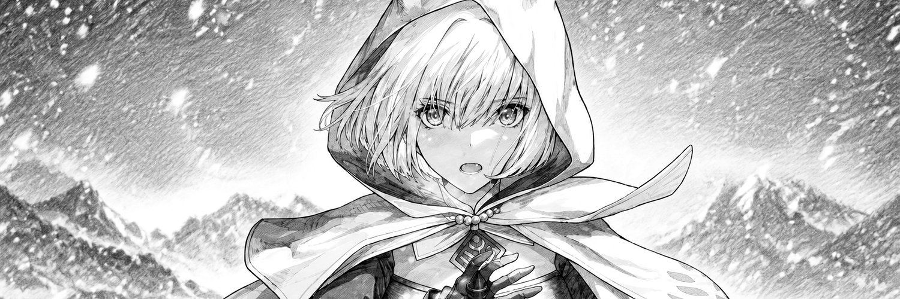
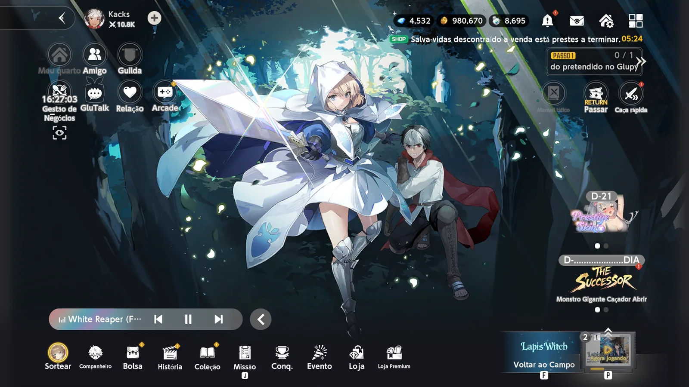
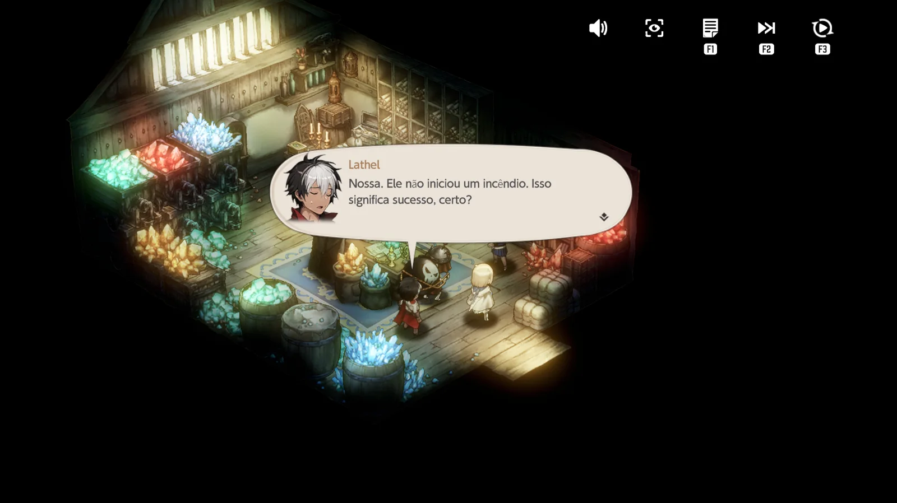
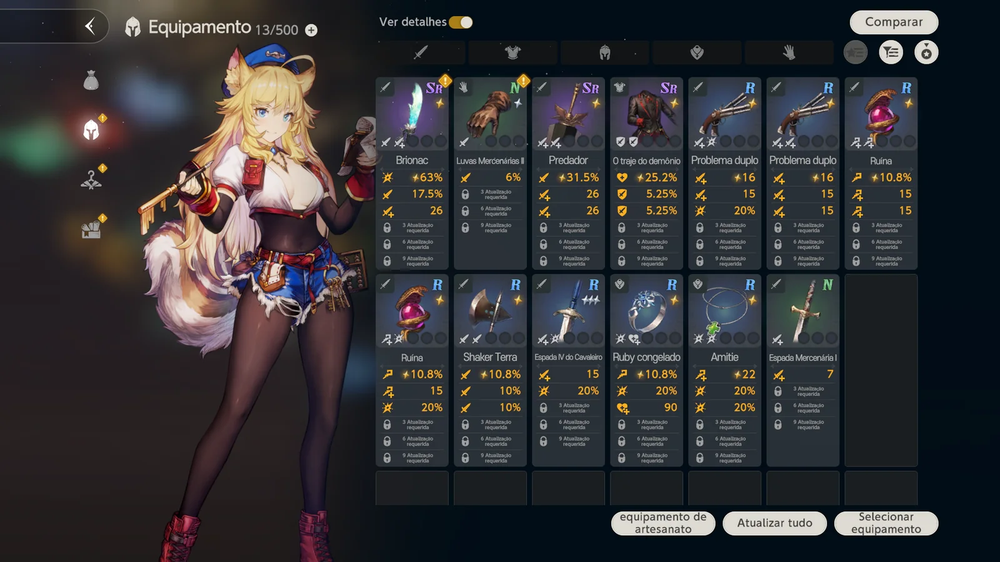
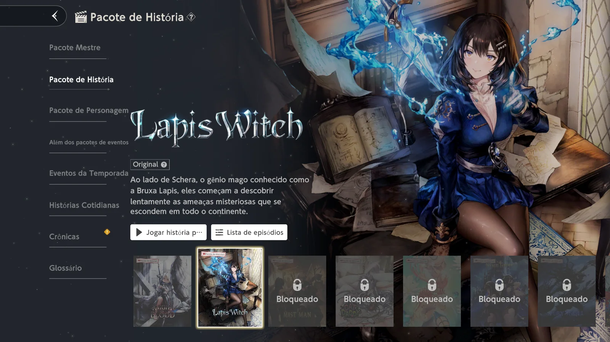
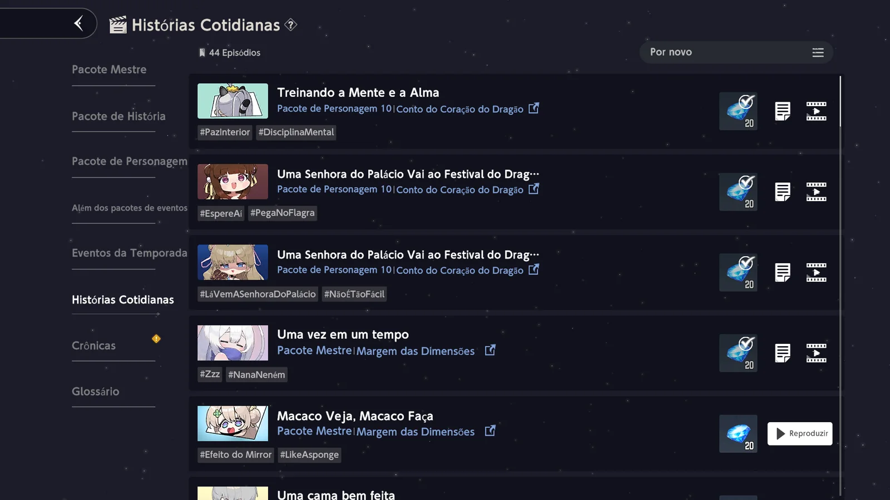
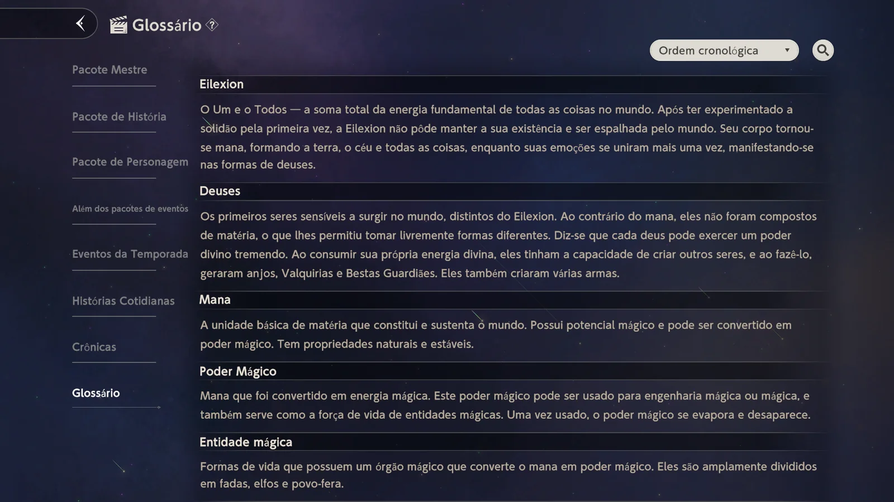
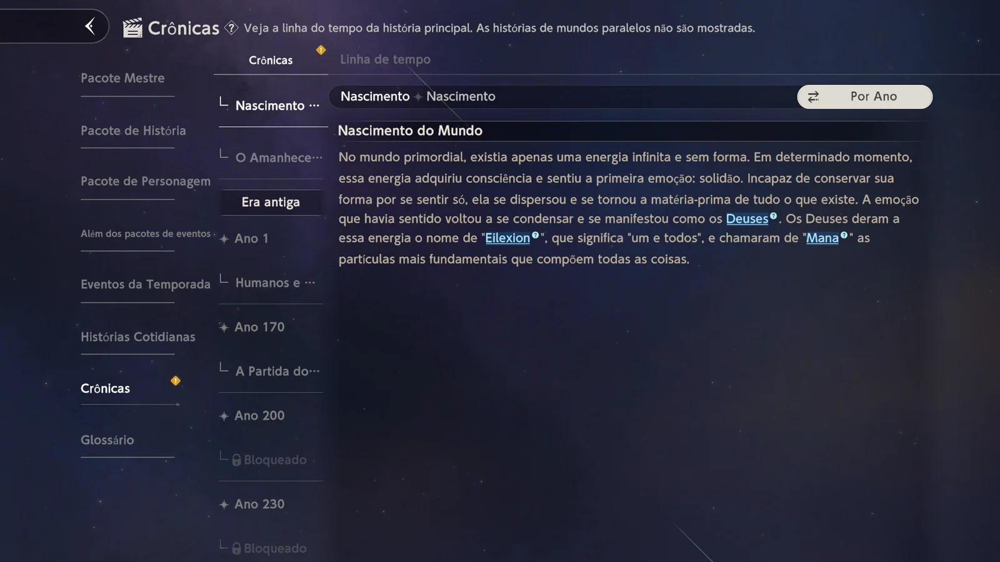
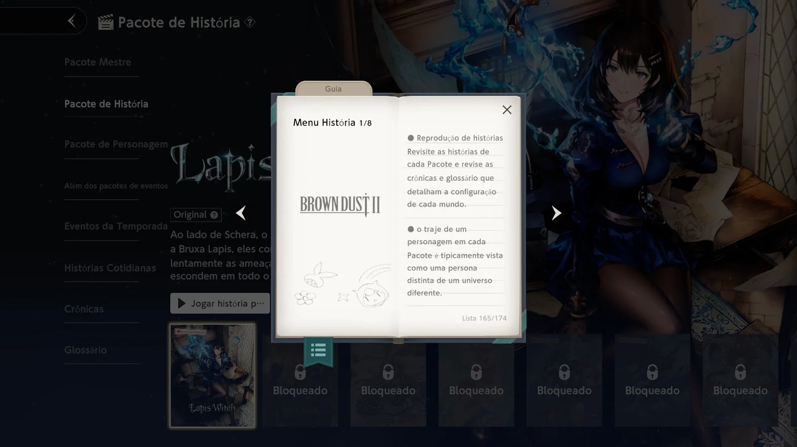

<picture>
  <source media="(prefers-color-scheme: dark)" srcset="./assets/bd2-hero-dark.png" />
  <source media="(prefers-color-scheme: light)" srcset="./assets/bd2-hero-light.png" />
  
</picture>

<h1 align="center">BROWN DUST 2 PT-BR / PC</h1>

<strong>TRADUÇÃO COMUNITÁRIA / BETA / WINDOWS X64</strong>

<code>GRATUITO</code>&nbsp;&nbsp;<code>ATUALIZADOR UNIVERSAL</code>&nbsp;&nbsp;<code>BACKUP E RECUPERAÇÃO</code>

  <a href="https://github.com/kacksdev/browndust2-ptbr/releases/latest"><strong>DOWNLOAD E VERSÃO ATUAL</strong></a>
  &nbsp;·&nbsp;<a href="./docs/INSTALACAO.md">INSTALAÇÃO E ATUALIZAÇÃO</a>
  &nbsp;·&nbsp;<a href="https://gamebanana.com/mods/706840">GAMEBANANA</a>

## 01 / O PROJETO

Brown Dust 2 PT-BR é uma tradução comunitária gratuita para a versão de PC do jogo. O projeto apresenta os textos do cliente em português brasileiro, preservando variáveis, formatação e elementos que devem permanecer no original, como títulos musicais.

A tradução é uma beta de cobertura ampla, com auxílio de IA e revisão incremental. Cobertura técnica não significa revisão humana integral: ainda podem existir escolhas literais, inconsistências ou textos novos sem tradução. O marco 1.0 fica reservado para uma etapa editorial mais madura.

Projeto criado, dirigido, mantido e validado por **Kacks**, sem afiliação, patrocínio ou endosso da NEOWIZ ou da GAMFS N.

## 02 / VERSÃO E COMPATIBILIDADE

A [Release atual](https://github.com/kacksdev/browndust2-ptbr/releases/latest) é a referência para versão, alterações, clientes validados, cobertura e hashes. O [canal estável do atualizador](https://raw.githubusercontent.com/kacksdev/browndust2-ptbr/main/updates/stable.json) informa os pacotes disponíveis e seus requisitos. O histórico fica nas [Releases](https://github.com/kacksdev/browndust2-ptbr/releases), sem exigir a reescrita desta página a cada atualização.

O aplicativo consulta o canal oficial do projeto e confere a identificação do cliente instalado antes de aplicar um pacote. Se não existir uma atualização compatível, ele informa o bloqueio e preserva a instalação existente.

Essa verificação não promete compatibilidade com qualquer versão futura do jogo. Atualizações oficiais podem acrescentar textos ou modificar a integração e precisam ser avaliadas pelo projeto.

## 03 / INSTALAR OU ATUALIZAR

1. Atualize Brown Dust 2 pelo Starter oficial e feche o jogo e o launcher.
2. Na primeira instalação, baixe **BD2PTBR.exe**, indicado na [Release atual](https://github.com/kacksdev/browndust2-ptbr/releases/latest).
3. Abra o aplicativo e confirme a pasta que contém `BrownDust II.exe`.
4. Use **Buscar atualização**, selecione **Instalar**, **Atualizar** ou **Reparar / Reinstalar** quando o pacote compatível aparecer e confirme a operação.
5. Aguarde a confirmação da operação e abra o jogo normalmente pelo launcher oficial.

Nas próximas atualizações do mod, abra o mesmo aplicativo e use **Buscar atualização**. Não é necessário baixar outro instalador para cada atualização do catálogo. Uma mudança de segurança ou de protocolo do próprio aplicativo poderá exigir uma migração, informada pelo projeto.

É necessária conexão com a internet para consultar o canal e baixar os pacotes por HTTPS do GitHub. A consulta não inicia o download sem sua confirmação.

O aplicativo também oferece **Verificar**, **Reparar / Reinstalar**, **Remover** e **Restaurar versão anterior**. O guia completo está em [Instalação e recuperação](./docs/INSTALACAO.md).

> **Code → Download ZIP não é o instalador.** Esse botão baixa o código-fonte. Use os arquivos indicados na Release.

## 04 / INTEGRIDADE E RECUPERAÇÃO

- Downloads limitados às Releases oficiais do projeto, por HTTPS, com verificação de tamanho e SHA-256.
- Compatibilidade conferida novamente antes da aplicação.
- Backup verificado antes de alterar arquivos gerenciados.
- Recuperação transacional de falhas e de operações interrompidas, sujeita à validade do cliente e dos backups.
- Restauração manual do ponto anterior somente com o mesmo cliente, backups íntegros e arquivos gerenciados sem alterações externas.
- Preservação de arquivos externos ao mod e bloqueio de alterações em executáveis ou bancos proprietários do jogo.

Os backups e o estado ficam em `%LOCALAPPDATA%\Kacks\BD2PTBR\instances`. Não apague essa pasta se pretende usar a recuperação.

**Restaurar versão anterior** recupera o estado local do mod; não reverte uma atualização oficial do jogo. Se a recuperação for bloqueada, preserve os backups e consulte o [suporte](./SUPPORT.md).

O executável não possui certificado comercial de assinatura de código. O Windows pode exibir um aviso de fornecedor desconhecido. Baixe somente pelas páginas oficiais e confira o SHA-256 da Release; não desative o antivírus para instalar.

## 05 / ATUALIZAÇÕES DO JOGO

O atualizador do mod não substitui o Starter da NEOWIZ. O Starter atualiza o cliente; o próprio jogo também pode baixar dados adicionais. Conclua essas etapas antes de atualizar o mod.

O botão **Abrir Starter oficial** abre o atualizador registrado pelo jogo naquele computador, sem caminho fixo nem comandos no Win+R. Ele não instala o mod; feche o jogo antes de usá-lo e conclua a atualização pelo aplicativo oficial.

Conteúdo acrescentado depois do catálogo publicado pode continuar em inglês. Uma tradução antiga só deve ser aplicada quando corresponder ao original esperado; incompatibilidades não são resolvidas forçando arquivos antigos.

## 06 / TRADUÇÃO EM JOGO

Capturas reais com a tradução ativa. Elas ilustram o projeto e não certificam, isoladamente, compatibilidade com clientes posteriores.

| Interface e equipamentos | Diálogo e história |
| --- | --- |
|  |  |
|  |  |

| Histórias e Crônicas | Glossário e Guia |
| --- | --- |
|  |  |
|  |  |

## 07 / CÓDIGO E TRANSPARÊNCIA

O repositório reúne o código do plugin e do atualizador, o catálogo publicado, as ferramentas e a documentação. A extração incremental identifica entradas novas e originais alterados por chave e hash, preservando traduções não afetadas.

O OpenAI Codex também auxilia na engenharia, automação, testes e documentação. Tradução direta por IA e verificações estruturais não equivalem a revisão humana integral. As decisões editoriais, os critérios de qualidade, a validação e a publicação permanecem sob responsabilidade do mantenedor. Consulte [Autoria e ferramentas](./docs/AUTORIA-E-FERRAMENTAS.md).

## 08 / SUPORTE E DIREITOS

Para relatar um problema, use as [Issues](https://github.com/kacksdev/browndust2-ptbr/issues) e informe a versão do mod, a versão do jogo, a tela afetada e o resultado esperado. Em falhas de instalação, inclua os detalhes exibidos no aplicativo, removendo informações pessoais. Consulte o [guia de suporte](./SUPPORT.md).

O código original e as contribuições autorais seguem os termos de [LICENSE](./LICENSE) e dos [avisos de terceiros](./THIRD-PARTY-NOTICES.md). Brown Dust 2 e seus materiais pertencem aos respectivos titulares. O projeto é gratuito, independente e não oficial.

<code>KACKS / COMMUNITY TRANSLATION / BRASIL</code>

